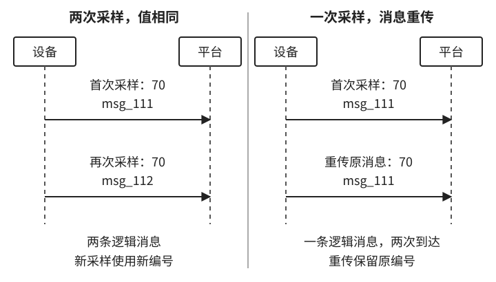
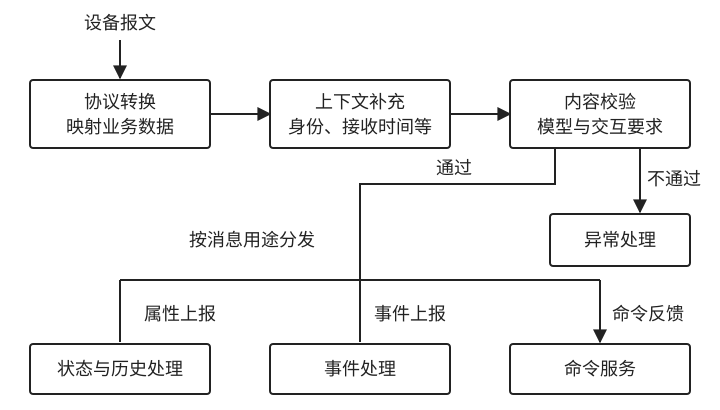

# 5.1 消息模型：一次设备交互需要携带什么信息

**消息模型规定一次设备交互如何表达。** 它包括消息的用途、设备归属、业务数据，以及识别和关联消息所需的编号。设备模型定义 `brightness` 的类型与范围；消息模型则说明某台设备在什么时候上报了这个属性，或者哪一次请求要求修改它。

平台据此完成三项工作：按消息类型选择处理流程，按设备模型解释数据，按消息与请求编号追踪交互。三者分别对应消息的分类、结构和关联规则。

<a id="_5-1-消息模型-设备能力如何在系统中流动"></a>
<a id="_5-1-1-属性数据-设备状态和参数如何传递"></a>
<a id="_5-1-2-可写属性-状态修改如何变成控制请求"></a>
<a id="_5-1-3-什么时候使用动作-而不是可写属性"></a>
<a id="设备主动上报"></a>
<a id="周期采集上报"></a>
<a id="平台主动查询"></a>
<a id="_5-1-6-消息中的通用信息"></a>
<a id="_5-1-1-消息类型标明交互用途"></a>

## 5.1.1 消息类型与处理职责

消息类型表示本次交互的用途。同一个 `brightness = 70`，放在属性上报中表示设备报告的值，放在控制请求中表示需要设置的值。接收方应先识别用途，再处理数据。

星云将主要交互分为以下四类。表中的名称属于平台内部约定，设备侧可以使用其他名称，由接入层转换。

表 5-1：主要消息类型、传递方向与平台处理职责。

| 消息类型 | 方向 | 内容 | 平台处理职责 |
| --- | --- | --- | --- |
| 属性上报 `property_report` | 设备 → 平台 | 属性名称与本次报告值 | 校验数据，更新状态或保存历史 |
| 事件上报 `event_report` | 设备 → 平台 | 一次事件及其参数 | 记录事件，交给业务处理 |
| 命令请求 `command_request` | 平台 → 设备 | 目标能力与调用参数 | 组织投递，跟踪执行 |
| 命令反馈 `command_reply` | 设备 → 平台 | 受理进展或执行结果 | 找到对应命令，更新处理记录 |

**能力决定数据的含义，消息类型决定数据的用途。** 属性设置和操作调用都可以用命令请求表达，具体执行什么由目标能力和参数决定。接收方不会因为两份消息带有相同属性，就把上报值和控制目标写入同一处记录。

主动上报、周期上报属于不同的触发方式，可以使用相同的属性上报结构。主动查询则需要请求与响应配对：返回值既可用于更新属性，也需要通知查询方本次请求已经得到答复。查询交互因此还要携带请求关联信息。

<a id="_5-1-2-业务内容与消息上下文"></a>

## 5.1.2 消息结构：上下文与业务数据

一条消息由**上下文和业务数据**两部分组成。业务数据通常放在 `payload` 中，保存属性值、事件参数或操作参数；上下文描述这份数据来自哪里、用于什么，以及按什么定义解释。

下面是一条完成协议转换后的属性上报：

```json
{
  "message_id": "msg_101",
  "device_id": "lamp_001",
  "type": "property_report",
  "model_version": "V1",
  "occurred_at": "2026-10-13T10:30:05+08:00",
  "received_at": "2026-10-13T10:30:07+08:00",
  "payload": { "brightness": 70 }
}
```

`device_id` 将数据归属到具体设备，`type` 指定处理类型。`model_version` 与设备的模型关联共同确定亮度值的校验规则。`occurred_at` 在这里表示设备采样时间，`received_at` 表示平台接收时间；两者分别保留，便于识别延迟上报。

这些字段构成平台内部的处理结构，不必全部由设备发送。接入层可以从已认证的连接中取得设备身份，从实例记录中查到模型信息，并自行填写接收时间。设备自行声明的身份仍需与连接或授权关系核对，版本信息也需要有明确来源。

字段是否必填取决于消息用途。命令反馈必须能够找到原请求，独立属性上报则不需要命令编号；设备没有提供采样时间时，应标记缺失，不能把平台接收时间当作确定的采样时刻。这样，结构既保留了处理所需的信息，也没有掩盖设备协议的限制。

<a id="_5-1-4-事件消息-设备如何报告发生过的事情"></a>
<a id="_5-1-5-命令消息-一次具体的控制请求"></a>
<a id="_5-1-3-消息身份与业务发生次数"></a>

## 5.1.3 消息标识与重复识别

**消息标识用于区分不同消息，并识别同一消息的重复到达。** 星云在本节采用的规则是：每条新产生的逻辑消息使用一个新编号，同一消息重传时保留原编号。接收方结合处理记录，判断它是否已经处理过这条消息。

这项规则区分了两种内容相同的上报。设备先后采样两次，亮度都为 70，这是两条消息；一次采样结果因网络重传到达两次，则仍是同一条消息。仅比较数据值无法区分两者。图 5-1 将这两种情况并列展示。



图 5-1：采样次数与消息到达次数的区别。两侧为独立示例，时间向下、不按比例，虚线为生命线；编号在同一设备的约定唯一范围内比较。右侧保留编号提供了重复识别依据，是否已经处理仍需查询处理记录。

消息编号还需要明确唯一范围。若设备使用启动后递增的序号，平台就需要结合设备身份和启动周期识别消息。若底层协议根本没有可跨重传保留的标识，平台每次接收时新生成的编号只能标记接收记录，无法据此识别设备重传。

事件标识与消息标识承担不同职责。一次告警可以先被设备上报，再被平台转成应用通知：两条消息编号不同，但可以引用同一个事件编号。事件编号追踪一次业务发生，消息编号追踪承载它的消息；只有在两者严格一一对应时，才可以共用。

编号提供去重依据，实际去重仍需要保存处理记录，并约定唯一范围和保留期限。超过保留期限后再次收到旧消息，系统未必还能识别它。

<a id="_5-1-7-消息模型连接设备模型和运行系统"></a>
<a id="_5-1-4-请求与反馈的关联"></a>

## 5.1.4 请求标识与反馈关联

一次命令可以产生多条消息，包括请求、受理回复、进度通知和完成回复。**这些消息各有消息编号，共同引用同一个命令编号。** `message_id` 区分消息，`command_id` 将它们归入同一次控制过程。

表 5-2：一次命令关联多条消息，独立属性上报不自动归入该命令。

| 消息编号 | 消息类型 | 命令编号 | 内容 |
| --- | --- | --- | --- |
| `msg_201` | 命令请求 | `cmd_301` | 设置亮度为 70 |
| `msg_202` | 命令反馈 | `cmd_301` | 设备已受理 |
| `msg_203` | 命令反馈 | `cmd_301` | 设备执行完成 |
| `msg_204` | 属性上报 | 无 | 独立报告亮度为 70 |

反馈内容还需包含所确认的阶段、结果以及必要的原因。命令编号只能说明它在回应哪次请求，不能说明请求是否已经执行；“已受理”和“已完成”必须有不同的表达。主动查询同样需要请求标识，但查询编号不必采用控制命令的命名。

独立上报不与命令自动配对。表中的 `msg_204` 可以更新亮度记录，但数值与目标相等，不能证明它由 `cmd_301` 导致。只有协议明确提供了关联方式，平台才有依据把上报用于确认该命令。

命令反馈到达时，平台应同时核对命令编号和设备身份。无法关联的回复应保留为异常记录；若设备协议不支持请求关联，也应明确暴露这项限制，不能把回复归给“最近发出的命令”。

<a id="_5-1-5-从设备报文到平台处理入口"></a>

## 5.1.5 消息接入与分发

平台接收设备消息，依次完成协议转换、上下文补充、内容校验和分发。协议转换沿用第四章的映射规则；上下文补充确定设备身份、接收时间等信息；校验检查消息是否符合模型及交互要求；分发将消息交给相应服务。图 5-2 展示设备消息进入平台后的主要处理路径。



图 5-2：设备消息的接入与分发。图中展示三类消息的主要去向，一条消息中的业务内容也可以交给多个服务；箭头表示处理方向，不表示各步骤处于同一事务。

属性上报进入状态与历史处理，事件上报进入事件处理，命令反馈进入命令服务。业务内容可以被多个服务使用，但各服务承担的职责仍然不同。例如，一份执行反馈同时包含亮度值时，命令服务处理执行结果，状态服务处理属性观测。

**接入层负责忠实转换设备已经表达的信息。** 设备只确认收到请求，平台就只能记录收到；设备没有提供采样时间或请求关联，转换后也不会自然获得这些信息。缺少某项必需信息的消息，应进入异常处理，避免形成错误的状态或完成记录。

消息模型由此提供了交互的基本单位。下一节讨论这些消息如何组成一条控制链路：请求如何被受理，设备反馈如何改变命令状态，应用如何取得结果。

[返回第五章](../05-message-state-control.md)
