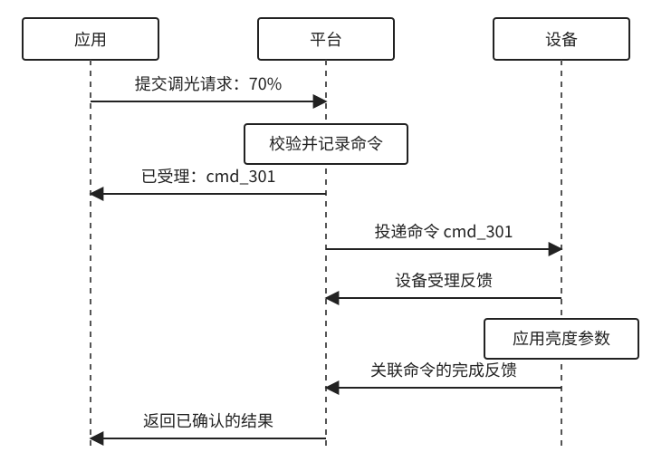
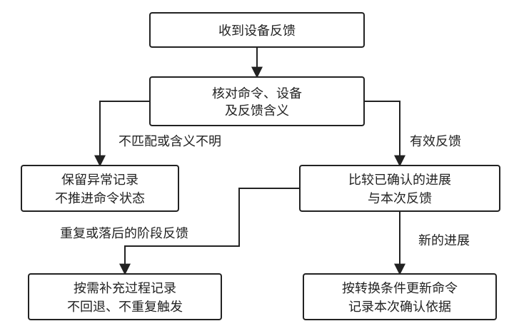
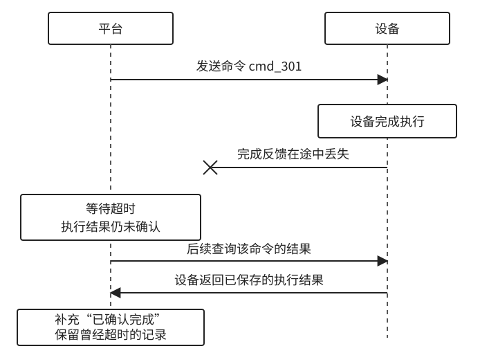

# 5.2 控制链路：一次命令如何形成闭环

**控制链路负责将一次操作请求交给设备执行，并向调用方提供进展和结果。** 它包括请求受理、命令投递、设备执行和反馈处理。命令记录贯穿整个过程，将这些环节关联到同一次操作。

平台需要分别管理命令进展、设备报告和等待期限。命令进展说明请求处理到了哪一步，设备报告说明最近观察到的状态，等待期限决定调用方何时结束等待。这三类信息共同支撑结果判断，但各自的含义不同。

## 5.2.1 控制链路的组成

控制由应用、命令服务、接入通道和设备共同完成。应用提交目标设备与操作参数；命令服务校验并记录请求；接入通道将请求转换成设备协议并投递；设备执行后返回反馈，由命令服务更新结果。

图 5-3 展示设置亮度为 70 的一次交互。平台先记录命令并返回编号，随后投递请求。设备的受理回复和完成回复分别确认两个阶段，应用通过后续通知取得结果。

图 5-3：调光请求的往返过程。时间向下，不按比例；虚线为生命线。平台一列合并命令服务与接入通道。图中设备分别报告受理与完成，其他协议可以只提供最终回复。

**命令服务保存整次请求的进展，各参与者只确认自己完成的环节。** 平台返回命令编号，表示请求已被受理；通道确认接手，表示消息已进入传递过程；设备反馈才说明本地处理情况。因此，应用应从命令记录获取执行结果，而不能把接口返回或发送日志直接当作设备完成。

设备反馈也可以携带属性值。此时，执行结果交给命令服务，属性值交给状态服务，分别更新命令与最近观测。这种分工使应用既能查询某次操作，也能查看设备状态。

## 5.2.2 命令受理与投递

**受理阶段确定这次请求能否进入执行流程，并为后续处理建立记录。** 命令服务检查调用权限、目标设备、支持的能力以及参数范围。检查失败时直接返回原因；这属于平台拒绝请求，尚未涉及设备执行。

检查通过后，平台保存命令编号、目标、参数、请求来源和有效期，同时登记待发送工作。以 `cmd_301` 为例，它始终表示本次“亮度设为 70”的请求。用户后来改设为 30，应生成新的命令，原记录不随之改写。

命令与待发送工作需要可靠保存，接口才能返回“已受理”。一种实现是在同一事务中写入命令及待发送记录，再由发送任务读取。这样，进程重启后仍能继续处理，也避免出现命令已保存、发送任务却丢失的情况。

投递阶段由接入部分选择设备连接、编码并发送消息。发送前检查命令是否过期、连接是否可用，以及设备是否仍支持该能力。对离线设备，可以拒绝即时请求，也可以在有效期内排队；选择取决于业务是否允许延后执行。

通道、网关和设备可能分别返回确认，平台应记录确认来自哪一层。网关收到请求，只能确认消息到达网关；设备还可能因正在升级等原因拒绝执行。只有设备回复受理后，命令才能记录为“设备已受理”；缺少这类回复的协议，则直接等待最终结果。

## 5.2.3 命令状态与转换规则

命令状态概括平台已经确认的处理进展。星云可以采用表中的状态，名称可以调整，但每个状态都应对应明确的进入条件。

| 命令状态 | 进入条件 | 含义 |
| --- | --- | --- |
| 待发送 | 命令与发送工作已保存 | 等待平台投递 |
| 已提交通道 | 通道确认接手 | 尚未确认设备受理 |
| 设备已受理 | 收到对应命令的受理回复 | 等待执行结果 |
| 已完成 | 收到符合完成条件的反馈 | 已确认本次操作完成 |
| 设备已拒绝 | 设备明确拒绝请求 | 本次请求未被受理 |
| 执行失败 | 设备明确报告执行失败 | 已确认失败，可能存在部分效果 |

**状态更新应反映已确认的进展，不能只按消息到达顺序覆盖。** 处理反馈时，先核对命令编号、设备身份和反馈含义，再与当前记录比较，决定是否更新，如图 5-4 所示。

图 5-4：反馈处理流程。重复或落后的阶段反馈不回退命令状态；相互矛盾的最终结果转入异常处理，不作为新的进展。

完成回复可能先于受理回复到达。平台可以先记录完成，再补记迟到的受理信息，无需退回“设备已受理”。同一回复重复到达，也不应重复触发完成通知。协议只提供最终回复时，则不必等待并不存在的中间确认。

当前状态用于查询，过程记录用于追溯。发送尝试、收到的回复、时间和原因都应保留，便于解释结果。并发处理反馈时，还需在写入前检查状态转换条件，防止较旧的处理结果覆盖已经确认的新进展。

## 5.2.4 操作的完成条件

**完成条件由操作定义决定，并通过设备协议中的反馈确认。** 调光操作可以约定：设备应用亮度参数后，返回带命令编号的完成回复。平台核对回复后，将对应命令记为完成。

命令完成与物理过程结束可能发生在不同时间。设置空调目标温度为 22℃，可以在设备保存并采用新设定值时完成，此时室温仍可能是 25℃。启动洗衣操作可以在设备进入洗涤程序时完成，洗涤结束则由后续事件报告。应用需要跟踪的是哪种结果，应在操作定义中说清楚。

属性上报能否用于确认命令，也由协议决定。带有可靠请求关联的状态反馈，可以按约定证明操作完成；独立的 `brightness = 70` 上报，只能说明最近观察到亮度为 70。它可能来自本地调节，不能仅因数值等于目标就认定某条命令成功。

设备反馈的证明范围还取决于硬件能力。固件确认应用了输出参数，不一定表示已经测量到相应的物理效果。模型应说明“完成”具体保证什么，应用据此展示操作结果，并在需要时另行跟踪物理状态。

## 5.2.5 超时、有效期与重试

超时表示平台未在期限内取得所需反馈。它可以发生在设备尚未执行时，也可以发生在设备执行完成、回复未到达时。因此，**等待超时应记录为结果未确认，与设备明确报告的执行失败分开。**

图 5-5 展示后一种情况。设备已经执行，平台先记录超时，随后通过查询取得执行结果，才补充完成结论。后来的确认不会抹去此前超时的记录。

图 5-5：反馈丢失后的结果确认。时间向下，不按比例；虚线为生命线，叉号表示反馈丢失。查询恢复依赖设备保存结果且协议支持查询。

等待期限控制调用方等待多久；命令有效期控制请求允许执行到什么时候。尚未投递的命令可以在到期后停止发送。已经发出的命令若要求到期后不得执行，还需要设备检查期限，并具有相应的时间依据。平台停止等待或停止重试，不会自动取消远端操作。

重试前需要判断原请求是否可能已被执行。已知未交付的请求可以在有效期内重新发送；交付情况未知时，应结合结果查询和重复执行风险决定。重发同一逻辑消息应保留消息与命令标识，单独记录发送次数；设备端还需保存去重记录，才能在约定期限内避免重复执行。

设置固定亮度虽然可以重复应用，但仍有顺序问题：后续命令已把亮度设为 30，旧的 70 请求重试到达，就会覆盖新结果。重启、闪灯三次等操作还会直接重复动作。因此，自动重试需要同时考虑有效期、去重和执行顺序；协议无法提供必要保证时，应查询结果或向应用明确返回未确认状态。

## 5.2.6 同步等待与异步查询

用户点击开关后，App 通常需要立即给出触摸反馈，再等待设备结果。这里的“立即响应”与接口采用同步还是异步，是两个不同问题。设计时需要分别确定界面怎样等待、接口什么时候返回，以及控件什么时候显示新值。

**界面不阻塞、接口异步返回、控件提前更新，是三个独立选择。** App 可以通过异步网络调用访问一个等待设备完成的接口，等待期间页面仍可滚动、返回，其他控件也可以使用。代码中使用 `await`，不说明服务端已经采用“先受理、后查结果”的接口，也不要求冻结整个页面。

同步结果接口在有限时间内等待设备反馈，得到完成或拒绝结果后直接返回。它适合响应较快、耗时相对稳定的操作，例如在线设备的一次简单设置。App 可以让当前控件显示短暂的“设置中”，其余页面继续响应。等待预算应根据设备响应分布和产品可接受的时间确定，不能仅因为演示时很快，就假设所有网络下都能及时完成。

异步结果接口先保存命令并返回编号，App 再通过查询或通知取得结果。它适合耗时不稳定、需要排队或允许用户离开页面的操作。HTTP 接口可以用 `202 Accepted` 表达受理，并提供状态查询入口；这种“受理后查询”的接口模式可参见 [Microsoft 的异步请求与响应设计说明](https://learn.microsoft.com/en-us/azure/architecture/patterns/asynchronous-request-reply)。HTTP 状态码需要与业务字段一起解释，受理响应不表示设备完成。

两种方式还可以组合：平台先建立命令记录，在短暂预算内等到结果就直接返回，未完成则返回命令编号及当前进展，让 App 转入后续查询。这样，快速操作可以在一次请求中结束，慢操作也有可恢复的查询入口。命令执行不应依附于这次 HTTP 连接是否仍然存在。

对于星云面向多类设备的控制入口，可以采用“命令可查询，快速结果允许直接返回”的约定。按钮是否必须等待完成、滑块是否立即跟手，则由下面的交互规则决定，无需把所有控件做成同一种等待方式。

## 5.2.7 控件显示值与设备确认值

App 中至少有三类值：用户正在编辑的本地值、已经提交但尚未确认的目标值，以及设备最近报告的值。它们可以暂时相同，也可以不同。用户把亮度从 50 拖到 70 时，滑块显示 70 说明用户选中了这个值，并不自动说明灯已经采用了它。

**控件可以立即表达用户意图，设备状态必须由有效反馈确认。** 对亮度这类重复设置代价较低、用户期待即时反馈的操作，可以先把开关或滑块显示为新目标，同时在控件旁标记“设置中”。这种先更新界面的方式通常称为乐观更新；待确认标记应让用户能够识别它与已经生效的状态。

页面也可以采用等待确认的方式：保持原设备状态，点击后显示“正在关闭”，收到完成反馈后再显示“已关闭”。门锁、投料或启动任务等操作，如果提前显示成功容易使用户作出错误判断，就更适合这种方式。按下按钮的视觉反馈仍然立即发生，等待的是业务结果。

无论采用哪种方式，都不必把全部命令阶段暴露给用户。“提交中”表示 App 尚未确认平台受理；“处理中”表示请求已经进入流程；“已完成”需要满足操作约定；“暂未确认结果”表示等待结束却缺少结论。错误原因应尽量说明用户能够采取的下一步，例如修改参数、等待设备恢复或查询结果。

设备明确拒绝设置时，可以撤掉待确认目标，重新展示最近有效报告，并说明失败原因。若报告已经过时，应带上观测时间或重新查询；不能把操作前缓存的值直接当作设备现在的值。执行失败也可能留下部分效果，页面显示需要以实际反馈为准。

超时则不能简单套用“失败后恢复旧值”。灯可能已经采用 70，只是回复丢了。此时可以保留“目标 70，结果待确认”，或在主控件旁显示最近报告值与未确认提示。**界面撤销一次乐观显示，不会让设备自动回到旧状态。** 如果用户确实希望恢复旧值，那是一次新的控制请求，需要重新执行并取得结果。

## 5.2.8 按钮、滑块与配置保存

不同控件表达的操作次数和完成条件不同。按钮通常发起一次明确动作；滑块在一次手势中会产生许多中间值；配置表单可能在用户编辑多个字段以后才一次提交。发送策略应围绕这些差异设计。

对于“重启”“闪灯三次”这样的动作按钮，点击后可以暂时禁用同一动作，并在按钮附近显示进展，其他无关功能保持可用。这能减少误触，却不能代替服务端防重复：用户可能返回页面再次点击，网络库也可能重发请求。App 应在首次提交前生成请求标识，提交响应丢失后沿用它恢复原请求；用户明确发起第二次动作时，再使用新标识。

开关表达目标值时，还应区分“设为开启”与“切换一次”。前者可以与用户最终意图对应，后者重复执行会再次翻转。如果允许用户在处理中继续修改，App 应保存最新目标，并让旧请求结果只更新原请求的记录；如果设备不支持目标顺序控制，则可以限制同一控件的并发提交，避免积压互相矛盾的操作。

**滑块的显示频率与命令发送频率可以不同。** 对不要求拖动时设备实时变化的设置，可以让滑块在本地跟随手指移动，松手后提交最终值。对希望边拖边看到灯光变化的调光功能，可以按受控频率发送中间目标，合并尚未发送的值，并在手势结束时确保最终目标被提交或已经提交。节流限制持续拖动中的发送频率；防抖等待一段时间没有变化才发送，两者适合的体验不同。

合并只适用于允许新目标替代旧目标的设置，不能用于“闪灯三次”这类必须逐次计数的动作。已经发出的请求也不能靠删除 App 中的队列撤回。若旧请求可能晚到，仍需平台和设备提供版本或顺序保障；具体规则在 5.4 展开。

例如用户先提交亮度 70，又提交 30，30 的完成反馈先到，70 的反馈后到。App 应按命令编号关联两次结果，不能让较旧请求的回调把滑块推回 70，也不能让旧请求的失败提示覆盖新请求的成功状态。设备随后上报的有效当前状态仍应正常展示；不能为了保持滑块稳定而忽略真实的本地操作或其他用户控制。

配置表单则可以保留本地草稿，用户点击“保存”后提交一组明确的字段。编辑未提交、平台已保存和设备已采用，应有不同提示。若接口承诺的是在线设备立即应用，那么只有设备完成后才能显示“已生效”；若承诺离线期间先保存目标，则平台持久保存成功后可以显示“已保存，等待设备同步”。后一种承诺需要下一节介绍的持续目标机制。

多个字段是否一起生效，也需要能力和协议支持。摄像头同时修改录像时长与侦测灵敏度时，如果设备逐项执行并可能部分失败，App 就应展示每项结果或明确的部分成功状态，保留尚未成功的编辑。单个“保存”按钮本身并不意味着设备具备整组原子更新能力。

## 5.2.9 超时提示与页面恢复

异步控制需要让用户能够结束等待，也需要让结果在页面离开后仍然可查。按钮旁的持续转圈适合短暂等待；超过前台等待预算后，可以改成“暂未确认结果”，提供查询入口，让用户继续使用其他功能。这个预算用于控制体验，与命令允许执行到什么时候分别管理。

**离开页面或取消网络请求，不等于取消设备操作。** 只有平台和设备提供明确的取消协议，App 才能展示“已取消执行”；否则应使用“停止等待”等准确表达。已经开始或完成的动作，还需要根据操作能力判断能否取消或补偿。

App 应保存尚未结束的命令关联，或通过有权限的服务端查询恢复这些记录。返回页面、重新联网或 App 重启后，重新查询命令进展和设备最近状态；前者回答“刚才那次操作怎样了”，后者回答“设备最近报告什么”。如果受理响应丢失、尚未拿到命令编号，可以用原请求标识查询或重新提交以恢复关联，不能立即生成一条新命令。

结果获取可以使用有界轮询，也可以由实时连接推送变化。推送有助于及时更新，但断线、后台暂停或订阅建立前都可能漏掉通知，因此需要状态查询作为恢复入口。实现上可以先建立订阅，再获取当前快照，并依据命令进展或记录版本处理期间的通知；采用轮询时则应限制频率，在完成、离开页面或转入后台后按策略停止，恢复前台时重新核对。

本节采用“通知提示变化，查询取得当前记录”的方式，可以减少 App 自行合并消息的复杂度。同一命令的重复通知不应重复弹出成功提示；较旧的查询响应也不能覆盖已经取得的新进展。用户已经离开当前设备页面时，结果可以保存在任务记录或设备页中，不必强行把用户拉回原页面。

超时后的“重试”还应说明具体含义。对结果未知的一次性动作，应优先查询原命令，或在协议保证下重传同一请求；“再执行一次”则是新的用户意图，需要新的编号。不能用一个没有说明的重试按钮，把查询结果和新增动作混在一起。

由此，一次控制在 App 上既有立即可见的操作反馈，也有持续可查的业务结果。下一节进一步讨论配置跨越设备离线的情况：目标已经保存以后，怎样在设备重新连接时继续同步，以及何时可以告诉用户“设备已采用”。

[返回第五章](../05-message-state-control.md)
