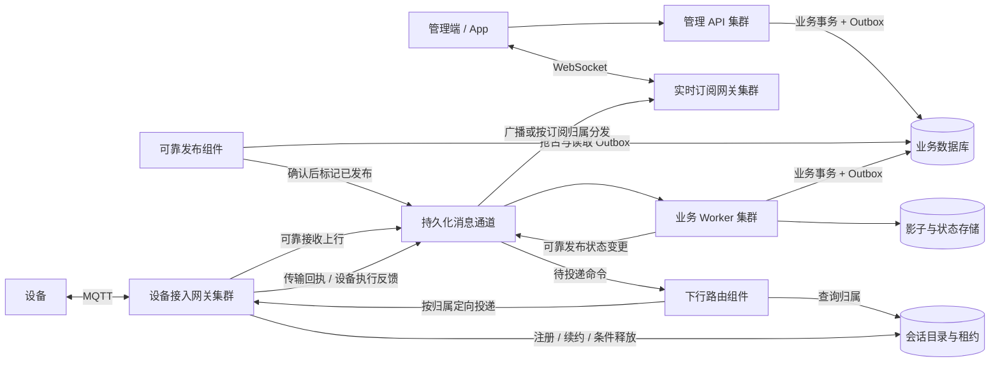

# 平台架构与开发约定

这是实战项目的架构、功能范围和模块模板约定的唯一来源。构建与启动命令见 [后端入口](../backend/README.md)；实现状态以代码和测试为准。

## 产品范围

建设包含平台运营、租户管理后台及 Java 后端的 IoT 平台。母婴暖奶器作为贯通案例，产品与接口面向多种设备；按下图保留完整功能范围，分阶段实现。


| 功能域 | 管理入口与主要能力 | 交付范围 |
| --- | --- | --- |
| 设备接入 | 自定义协议、南北向接入、实例与通道、联通测试、同步记录；MQTT／HTTP、TCP／UDP／CoAP／WebSocket、OPC-UA／Modbus及厂商连接器 | MQTT 与 HTTP 纳入核心，其余逐项扩展 |
| 设备管理 | 产品分类、产品草稿与发布、物模型版本、设备注册／批量导入、凭证、生命周期、归属、状态历史、事件、控制、配置和影子 | 核心 |
| 规则引擎 | 触发条件、动作、规则版本、启停与测试、场景联动、执行轨迹和失败恢复 | 核心 |
| 告警与流转 | 告警策略与严重度、去重抑制、通知、实例确认／恢复；转发目标、规则与投递记录 | 核心 |
| 系统管理 | 登录、租户、用户／成员、组织部门、角色、菜单按钮、资源权限、关系配置、第三方身份和平台配置 | 基础管理纳入核心，第三方集成逐项扩展 |
| 运维管理 | 协议版本、网关、网络组件、证书到期与轮换、通道、日志、指标、健康与诊断、OTA、流媒体配置 | OTA 与基本运维纳入核心，流媒体随视频扩展 |
| 应用与 OpenAPI | 应用登记、凭证轮换、接口授权、文档、调用记录、限流、事件订阅及失败投递 | 核心，外部连接器逐项扩展 |
| 视频中心 | 视频设备／通道、直播、录像检索／回放、分屏、国标级联与推送 | 专项扩展 |
| 可视化 | 大屏、2D 组态、素材资源、数据源绑定、预览、版本、发布和访问授权 | 专项扩展 |

上方技术组件也有管理入口：网关连接与会话、消息主题／订阅／连接器／积压／失败重放、规则执行轨迹，以及历史保留／导出／容量和存储适配器健康。共享监听、数据库实例与备份等由平台运维管理，租户操作其授权资源。页面开放以真实端到端能力完成为准。

## 工程与模块规划

基线为 Java 21、Spring Boot 3.5.16、Maven 多模块，保留模块化单体的开发与本地运行方式。第一版集群建设必须支持运行角色分离和多实例验证，具体边界、阶段与验收要求见下方“集群与服务拆分规划”。按独立扩容、故障隔离、发布节奏及团队责任评估进一步拆分；拆分时需要明确数据归属、远程契约、消息与部署验证。

组织方式参考 JetLinks 社区版 2.11 的 [组件层](https://github.com/jetlinks/jetlinks-community/blob/2.11/jetlinks-components/pom.xml)、[管理层](https://github.com/jetlinks/jetlinks-community/blob/2.11/jetlinks-manager/pom.xml) 与 [运行组装](https://github.com/jetlinks/jetlinks-community/blob/2.11/jetlinks-standalone/pom.xml)。采用核心契约、能力组件、业务管理、启动组装的划分；具体技术按本项目需要选用。

以下结构同时列出现有模块和目标模块；未注明已实现的扩展能力按需建立，不预建空模块。

```text
backend/
├── pom.xml                         父工程与版本管理
├── platform-core/                  共享标识、物模型、消息、设备操作、认证和协议契约
├── platform-components/            能力组件聚合（已建立）
│   ├── network-component           已实现Vert.x MQTT 5设备接入
│   ├── protocol-component          已实现默认MQTT协议及系统校时；预留协议SPI
│   ├── gateway-component           已建立通用接入、设备解析与上行端口
│   ├── message-component           已实现 JVM 内事件分发；可靠交付待实现
│   ├── media-component             已实现统一观看信令端口与 AWS KVS WebRTC 适配
│   ├── rule-component              条件评估与动作运行
│   ├── storage-component           存储技术配置与适配能力
│   ├── notification-component      通知渠道、模板与投递
│   └── file-component              文件与制品存储、下载授权
├── platform-manager/               业务管理聚合（已建立）
│   ├── identity-manager            账号认证、RBAC 和菜单维护
│   ├── tenant-manager              租户、成员维护及审计；部门、配额待实现
│   ├── device-manager              已实现产品草稿／发布版本、设备登记／凭证／生命周期；状态、命令、配置和影子后续实施
│   ├── access-manager              协议、网络与网关配置及诊断
│   ├── rule-manager                规则定义、版本与场景联动
│   ├── alarm-manager               告警策略、实例与处理
│   ├── ota-manager                 固件、灰度策略、升级任务与进展
│   ├── integration-manager         应用、第三方平台、订阅与数据流转
│   ├── operations-manager          审计、日志与运行管理
│   ├── video-manager               已实现直播观看授权、会话及平台信令；录像／回放待扩展
│   └── visualization-manager       大屏、组态、资源与数据源绑定
├── platform-bootstrap/             Spring Boot 应用组装与启动
├── module-template/                现有业务管理模板
└── scripts/New-Module.ps1           现有同级模块生成脚本
```

依赖方向为启动应用 → 管理模块 → 能力组件／core；能力组件可依赖 core 与明确声明的其他组件契约，core 主代码仅依赖 JDK。组件通过端口调用业务提供的适配，不反向依赖 manager；管理模块之间只使用公开契约，禁止循环依赖、跨实现调用与跨模块改表。

状态、命令和配置先在 device-manager 内分包，保持规则与数据边界，按实际复杂度再拆 JAR。各领域拥有自己的表和存储端口，storage-component 提供技术支撑及通用存储适配，不集中承载所有领域 Repository。管理 API 与 OpenAPI 在所属模块的入口层调用同一用例，分别校验身份与授权。

## 集群与服务拆分规划

本节是后续集群建设与服务拆分的指导基线，记录目标设计，不表示下列能力已经实现。当前仍有 JVM 内 EventBus、本机设备连接与下行调用、本机在线状态和实时订阅状态等限制；完成状态以代码及多进程集成验收为准。下文“第一版”指第一版集群能力交付。

### 目标与边界

- 第一版必须打通真实跨节点的设备上行、命令下行、状态处理与实时通知，不能只保留接口或配置开关。
- 代码模块、运行角色与部署服务分别设计；一个角色可以装配多个模块，同一模块的 API 和后台消费者可以装入不同角色。
- 保留同一仓库与 Maven 工程，账号、租户、产品等无需各自拆成服务。不为未来能力预建空服务。
- 本地可组合运行，集群可按角色扩容；需要可靠交付的业务语义不因部署方式不同而改变。
- 应用多实例与基础设施高可用分别验收。多个应用连接单个数据库或消息节点，不等于端到端高可用。

### 目标逻辑架构

下图表示职责和链路，不要求每个方框独立部署。Worker 的状态变更须经过下文约定的可靠发布边界。



“确认后标记已发布”指 Relay 收到可靠消息通道确认后更新数据库 Outbox 状态；发布与标记之间崩溃可能造成重复，消费者必须幂等。

### 第一版运行角色

| 角色 | 装配职责 | 扩容依据 |
| --- | --- | --- |
| management | 管理 API、账号租户与产品设备用例、命令受理、实时订阅入口 | 请求量、实时客户端连接数 |
| access | MQTT 等设备接入、身份校验、编解码、连接管理、上行可靠接收与下行发送 | 设备连接数、流量 |
| worker | 上行消费、影子与状态更新、命令反馈、Outbox Relay、下行 Router、超时及恢复任务 | 消费积压、任务量 |
| all | 将上述职责组合运行，用于本地开发和轻量部署 | 开发便利性 |

Realtime 第一版可与 management 同进程，Relay 和 Router 可与 worker 同进程，但保留明确组件边界。角色名称为规划名称，配置与启动命令在实现时维护到后端 README。禁用某个角色时，不应意外启动其监听端口、消费者或调度任务。

跨角色通过明确的查询、命令或事件契约交互，不能依赖另一进程内的 Bean。设备认证、模型获取与资格撤销需确定远程查询或本地投影方案，并明确缓存期限和失联行为。第一版可共享数据库实例；同一领域的 API 和消费者可通过该领域用例访问其表，其他领域不得绕过契约读写实现细节。独立数据库不是第一版前提，也不引入默认的跨服务事务。

### EventBus 与可靠消息适配

`message-component` 负责事件契约与传输适配。现有 `LocalEventBus` 和 `supportsCluster()` 只是起点，不能据此宣称可靠集群交付。第一版实现一个可靠消息适配即可；RabbitMQ 是候选，最终选型、版本与持久化配置在实现前根据确认、消费组、路由、恢复及运维要求验证并记录。不同时实现多种中间件。

必须明确以下语义：

| 项目 | 约定 |
| --- | --- |
| 发布结果 | 区分本地回调完成、消息可靠接收、业务处理完成；业务不能依赖 publish 返回就表示所有业务完成 |
| 事件信封 | 稳定 eventId、事件类型及 schemaVersion、可信租户与设备身份、发生与接收时间、关联 ID、追踪信息；禁止依赖任意 Java 对象的隐式序列化 |
| 消费组 | 同组实例分担任务，不同业务组独立收到所需事件；影子、规则、历史存储不能误放到一个竞争消费组 |
| 广播与定向 | 实时通知、缓存失效与节点定向投递明确区分；不能把全部消息混用一个队列和策略 |
| 消费确认 | 业务效果可靠保存后确认，失败有界重试、退避、失败保留与重放入口 |
| 幂等 | 至少一次交付；去重键包含消费边界与事件身份，去重保留期限覆盖约定的重放范围 |
| 顺序 | 按需要使用设备键分区或串行处理，并处理重试、重连和迟到事件；不承诺全局有序 |
| 资源边界 | 消费并发、预取、内存队列、重试与消息保留均有上限，积压可观测并能施加背压 |

本地适配可以服务轻量开发与单元测试，但不能静默替代集群配置要求的持久化适配。业务依赖的能力应在启动时校验，缺少能力时明确失败。

### 设备会话归属与下行闭环

在 gateway 边界建立 `DeviceSessionDirectory` 与 `ClusterDownlinkRouter` 等职责，具体接口名可随实现优化。会话目录记录 `deviceKey → nodeId + sessionId + epoch + leaseUntil`；真实网络连接仅由对应 access 节点持有。节点标识需区分进程重启后的实例代次。

- 会话获取、续约、替换与释放须原子化；旧会话只能按自身代次条件释放。epoch 的生成及存储故障恢复必须保证不会让旧拥有者重新获得有效身份。
- Router 查询归属并定向投递，目标网关发送前重新检查会话和命令有效期；设备迁移后允许受控重查，禁止无限转发。
- 节点失去租约或无法确认所有权时停止以拥有者身份发送；新旧节点竞争、网络分区和共享存储故障必须纳入验证，不能只依赖 TTL 声称解决双主问题。
- 会话目录用于路由，业务在线状态用于查询展示，两者不混用。旧节点的迟到断线事件不得覆盖新会话状态。
- 第一版保留设备断线后重连的恢复方式，不承诺在节点间迁移已有 TCP 连接或提供 MQTT 持久会话。

下行按“授权并保存命令及 Outbox → 路由 → 网关发送 → 传输回执 → 设备执行反馈 → 命令状态更新”闭环处理。离线、过期、路由失败、传输结果未知与执行失败分别表达。重试保留 commandId；非幂等设备操作需设备端去重或明确的禁止自动重发策略。重新发送前复核设备资格，不能用旧命令绕过设备停用或权限撤销规则。

### 数据一致性与故障恢复

API 和 Worker 的数据库业务变更与 Outbox 在同一事务保存。Relay 多实例通过短事务抢占或租约分担工作，不长时间持有数据库事务等待网络；发布确认后标记完成，故障后可重新领取。数据库消费者将业务效果与 Inbox 去重记录在同一事务提交；外部副作用仍需其自身的幂等或补偿机制。

影子当前以 Redis 保存 reported、desired 与版本，不能假设数据库 Inbox、Redis 更新、消息发布存在共同事务。实现集群影子前必须落定并验证一种一致性方案：例如在同一可原子操作范围内写入影子与持久待发布记录，再可靠转发；若采用事件日志驱动可重建投影，则须先明确日志权威性、完整保留与重建边界，并同步修订现有影子存储约定。单独的“更新 Redis 后发布事件”不足以完成可靠闭环。

MQTT QoS 1 上行在进入约定的可靠存储边界后再返回成功 PUBACK，不等待所有下游业务完成。发布结果未知时按可能重复处理；去重身份不能仅依赖 MQTT 包标识。QoS 0 不具备相同的设备侧确认与重传保障。设备主动重发、Worker 崩溃和消息重放均需验证。慢消费者不能无界占用接入线程或内存。

### 共享状态与实时订阅

| 状态或行为 | 集群要求 |
| --- | --- |
| 管理登录 Session | 使用共享会话存储，保留 CSRF 与账号授权复核；请求切换实例后可正常使用 |
| WebSocket 票据 | 跨节点可验证、原子一次性消费、有期限，不能依赖发票节点内的 HttpSession 对象 |
| WebSocket 连接 | 留在本地；第一版可逐节点接收通知并过滤本地订阅，后续按连接归属定向分发 |
| 实时事件 | 明确广播范围和租户授权；断线重连通过快照及版本恢复，实时推送不充当唯一事实来源 |
| 本地缓存 | 跨节点失效配合版本与有效期，通知丢失后能收敛 |
| 凭证轮换与停用 | 跨节点撤销连接，认证、上行及下行持续执行适用的资格检查；明确撤销生效窗口与失联策略 |
| 调度与后台任务 | 通过抢占、分区或租约防止重复推进；租约不替代业务幂等 |

基础节点身份、租约等能力可按需要形成 `cluster-component`，消息适配仍属于 message，会话路由属于 gateway，业务状态属于各自 manager。避免建立包揽所有分布式逻辑的通用组件。

### Worker 扩展与进一步拆分

Worker 是运行角色，业务逻辑属于各自领域模块，启动层只负责装配。不同消费者即使同进程，也应隔离并发、队列、超时和重试资源，避免外部接口阻塞设备状态及命令处理。

| 能力 | 所属职责 | 引入时机 |
| --- | --- | --- |
| 上行、影子、状态、命令反馈 | device-manager 的后台入口与用例 | 第一版 |
| Outbox、路由、超时恢复 | 消息和网关组件及对应业务任务 | 第一版 |
| 规则与场景联动 | rule-manager / rule-component | 后续核心 |
| 告警去重、抑制、恢复与流转 | alarm-manager | 后续核心 |
| 通知、Webhook 与外部转发 | notification-component / integration-manager | 后续核心 |
| OTA 批次推进、反馈与超时 | ota-manager | 后续核心 |
| 历史入库、聚合、归档 | 对应数据业务模块与存储适配 | 按负载引入 |
| 导入、导出、批量操作 | 各所属业务模块 | 按产品需求引入 |

当出现持续积压、明显不同的资源需求、故障隔离要求或独立发布需求，再提取 `worker-device`、`worker-rule`、`worker-integration`、`worker-ota`、`worker-storage` 等部署组合。Realtime 可按连接规模独立部署。每次拆分明确数据所有权、消息及查询契约、权限、失败恢复与观测方式，不以模块数量或目录数量决定服务数量。

### 实施顺序与交付验收

1. 梳理本机状态和跨角色调用，确定事件交付、序列化、设备身份、会话租约与命令状态契约；完成消息适配及影子一致性选型。
2. 建立 management / access / worker / all 角色装配，接入可靠消息适配，完成 Outbox、幂等消费及失败恢复的最小闭环。
3. 实现会话目录与定向下行，跑通不同节点上的管理请求、设备连接、上行处理与命令结果。
4. 补齐共享登录、实时票据与广播、缓存失效、跨节点撤销和任务抢占。
5. 提供多实例部署样例、故障测试、监控和恢复说明；再逐步增加规则、告警、OTA 等消费者。

第一版集群交付必须完成以下验收，不以单进程测试替代：

- 至少启动两个 management、两个 access 和两个 worker 实例；同一登录会话在管理节点间切换可正常请求。
- 设备连接 access B，命令经任一 management 和 worker 路由后正确送达；命令状态能关联传输及执行反馈。
- 同组 Worker 分担消费，不同业务组各自收到事件；重复消费不重复产生业务效果。
- 杀掉接入节点后设备可重连另一节点；旧事件不覆盖新会话，失效路由和命令期限正确处理。
- 模拟租约失效、网络分区与共享存储不可用，节点不会继续使用失效所有权发送。
- 在发布确认前后、业务提交后消费确认前、影子更新及通知交界处注入故障，验证恢复、去重与通知最终可达或快照可恢复。
- 消息通道短暂不可用时不虚报成功；恢复后待处理工作继续推进，重试有上限、失败可查询和重放。
- 连接不同 Realtime 节点的客户端均能接收授权范围内的更新，票据不可重复使用，重连能恢复当前状态。
- 凭证轮换、设备或租户停用能在约定窗口内作用于相关节点；不会跨租户投递或查询。
- 优雅停机停止接收新工作并处理在途任务；强制退出后由租约、重试及设备重连恢复。

监控至少覆盖节点及角色健康、连接与租约、Outbox 积压及最老等待时间、消费延迟、重试及失败消息、路由失败、命令超时和实时推送丢弃。以事件 ID、命令 ID、设备键和 traceId 关联跨进程日志。基础设施部署另行明确数据库、Redis 和消息通道的持久化、复制、备份恢复与可接受的数据丢失窗口；开发用单节点编排不能当作生产高可用验收。

### 持续修订约定

本规划是可演进的工作基线，不是永久冻结的架构。后续实现、测试、性能数据或产品需求证明某项设计不合适时，允许并应当修改优化，不应为了机械遵守旧文档而保留已知问题。

- 开发相关功能前阅读本节；发现冲突时先说明事实与原因，再在同一变更中更新设计、实现及相关验证，不能静默偏离。
- 区分已实现、目标和待决策内容。只有代码与相应集成验收完成后，才将能力标为已交付。
- 修改运行边界、交付语义、数据权威来源、租约策略或中间件选型时，记录日期、原因、影响及验证依据；涉及已有数据或调用方时说明迁移或兼容策略。
- 新决策直接更新对应正文，删除或改写已失效约定；避免追加互相矛盾的例外或建立平行规划。
- 在每个集群阶段完成后，以及新增 Worker 类型、拆分服务或发生相关故障后复核本文。文档持续更新是交付的一部分。

| 日期 | 修订 | 原因与状态 |
| --- | --- | --- |
| 2026-10-18 | 建立集群与服务拆分规划 | 明确三个初始运行角色、可靠消息与会话归属、Worker 演进及多实例验收；属于目标规划，尚未据此完成集群验收 |

## 父工程与三类模板

继承链为 `spring-boot-starter-parent → nebula-platform-parent → 子模块`。父工程统一 Java、编码、依赖版本与插件管理，子模块显式声明所需依赖；模板是复制脚手架，不是运行依赖或业务基类。普通模块打包 JAR，运行应用才启用 Boot 重打包。官方机制见 [Spring Boot Maven 文档](https://docs.spring.io/spring-boot/3.5/maven-plugin/using.html)。

| 类别 | 代码组织与约束 | 当前落实情况 |
| --- | --- | --- |
| 核心契约 | 按 identity、device、model、message、command、auth、protocol 等语义分包；不强套五层，不依赖 Spring或具体存储／通信实现 | platform-core 已实现首版，详见其 [API 说明](../backend/platform-core/README.md) |
| 能力组件模板 | 接口／SPI、默认实现及供应商适配；只声明实际所需的网络、消息或存储依赖；不包含管理 CRUD 与控制器 | 约定已确定，专用生成模板待建立 |
| 业务管理模板 | api、application、domain、infrastructure、interfaces 五层；管理用例、权限、事务和生命周期 | module-template 与同级生成脚本已存在 |
| 启动应用模板 | 依赖与配置装配、启动、健康和运行角色；不承载业务决策 | platform-bootstrap 已存在，独立运行角色模板按需提取 |

业务模板分层：api 提供公开接口／请求结果／事件，application 编排用例并检查权限及事务，domain 保存领域对象／规则／端口，infrastructure 实现存储／消息／外部适配，interfaces 承接 HTTP／消息／调度入口。小模块只实现需要的层，不强制每个类都有接口，不预建统一 BaseService 或 BaseController。

现有脚本仅支持后端根目录下创建同级业务模块、替换坐标与包名、登记根 reactor，不支持嵌套聚合、组件模板选择或自动装入应用。已建立的组件使用正确的子模块parent.relativePath、聚合POM与根reactor，并通过构建；当前手动创建组件，生成脚本的嵌套及类型扩展后续实施。模板的使用命令只维护在 [后端入口](../backend/README.md)，实际分层约束链接到本节。

## 管理与租户边界

管理 API 使用 Spring MVC、Spring Security 和服务端 Session，保留 CSRF 保护，通过 `management` profile 启用 PostgreSQL、MyBatis 与 Flyway。账号、租户、成员、角色和菜单均已持久化；请求实时复核账号状态和授权，不把权限固化到 Session。

普通账号固定绑定一个租户，成员表的唯一约束和复合外键保证归属一致；业务读写校验有效成员，写操作要求 OWNER／ADMIN。平台超管身份独立初始化，不从用户名或角色推断；产品设备管理允许超管跨租户访问，包括无租户数据。无租户归属不代表共享。产品目录是平台共享数据，所有租户读取同一份目录，仅超管维护。

功能权限采用用户 → 角色 → 权限点，页面授权关联服务端接口能力。授权变更检查操作者权限上限，不扩大原有只读能力；账号、角色和菜单修改使用 revision，过期请求返回冲突。租户职责与后台功能角色独立，功能授权不能替代资源归属检查。

产品草稿可修改，已发布模型不可覆盖，设备固定绑定已发布版本。产品、设备和模型的范围由数据库复合外键约束；生命周期独立于在线状态，退役不可恢复。凭证当前同时保存 BCrypt 哈希和可查询的明文，按 `device:credential` 授权查看或轮换；管理登记凭证已接入正常MQTT认证：ClientId和用户名均为设备ID，密码为当前密钥；仅ACTIVE设备、启用产品和启用租户可接入，物模型取设备绑定的已发布版本。

管理前端独立构建，通过同源代理访问 API，以 HttpOnly Cookie 承载会话，不在浏览器存储账号或权限；退出清理状态并取消在途请求。服务端持续校验授权和归属，隐藏菜单不能替代接口检查。

接口、字段和操作步骤分别维护在 [后端说明](../backend/README.md)、[设备管理说明](../backend/platform-manager/device-manager/README.md) 和 [前端说明](../console/README.md)，本文件不重复接口表和迁移记录。

## 消息、状态与持久化

上行：设备 → 认证／解码 → 可信上下文补齐 → 模型校验 → 消息路由 → 状态、反馈、规则消费者 → 存储与查询。

下行：应用身份与资源授权 → 校验并保存命令和待发送工作 → 消息路由 → 当前会话网关 → 设备 → 关联反馈。

联动：有效事件 → 规则评估 → 保存触发及动作 → 命令／告警／转发用例 → 各自结果记录。规则引擎评估条件，告警域管理告警生命周期，连接器负责流转投递；提供防循环与重复执行控制。

必须保持以下约束：

- 设备身份、凭证、生命周期、连接和绑定分别表达；在线不自动代表可控，断线不删除设备身份。
- 命令受理、传输接受、设备执行与最近报告分别记录。等待超时表示结果未确认；独立属性值等于目标不能证明命令完成。页面区分编辑值、待确认目标与最近报告。
- 反馈核对设备与命令关联；重复或较早阶段反馈不回退进展，矛盾最终反馈进入异常处理。迟到结果可补充确认，但保留超时历史。
- 重传保留原关联，新用户意图创建新命令；过期工作不重新发送。去重、有效期、顺序及结果查询共同支撑恢复；不能只按设备时间戳覆盖状态。
- MQTT Broker 处理设备通信，内部总线承担业务路由，两者交付保证分别定义。普通进程内回调不能替代持久化工作交付。

PostgreSQL 是业务事实的规划基线；各模块拥有自己的数据，命令／动作与 Outbox 工作在同一事务保存。消费者按业务边界去重，有界重试、失败保留和恢复入口，以至少一次交付设计。设备影子的 reported、desired 和版本保存在 Redis，不设 TTL，由 Redis 持久化和备份负责恢复；账号、登记与模型仍以 PostgreSQL 为准。其他缓存、会话定位和限流数据按具体需求引入。

遥测、历史和日志按查询、保留周期与负载评估独立存储适配；参考图中的多种数据库是候选，按需求引入。迁移、备份恢复、升级、历史保留及凭证轮换属于交付要求，管理基础采用PostgreSQL（本地编排为17）、MyBatis Spring Boot Starter 3.0.5及Boot依赖清单管理的Flyway；Broker与其他存储版本按相应实现确定。

`practice` 项目允许为功能演进直接进行破坏性数据库变更。已有数据量较小时，可以在迁移中直接删除旧表、旧字段或不再适用的记录，再按新模型建立结构和数据；不要求为旧结构保留兼容字段、双写逻辑、兼容读取或过渡迁移。只有在需求明确要求保留历史数据或兼容既有调用方时，才增加相应的数据迁移和兼容处理；执行会删除数据的迁移时仍需在迁移说明中写清删除范围及原因。

## OTA 闭环

OTA 纳入核心：固件包记录租户、产品、硬件兼容性、目标版本、大小、摘要和验证信息；文件存储与元数据分开，下载受权限和有效期限制。

升级任务冻结包版本与目标设备集合，配置灰度批次、并发、有效期、离线与失败阈值策略。任务与设备进展分别记录受理、通知、下载、校验、安装、重启和版本确认，按协议证据判定成功；超时、重复、乱序、断线和重启可恢复追溯。重试保留尝试历史。

暂停／取消停止后续调度，已在安装的设备按协议处理；回滚需要设备与固件支持。所有发布、创建、下载、重试和查询均受租户及资源权限控制。

## 首版 MQTT 接入约定

Vert.x MQTT 5.1.10提供服务端端点，通过MqttEndpoint直接向认证后的当前设备会话发送PUBLISH；设备不发送SUBSCRIBE，服务端也不创建隐式订阅。业务依赖DeviceAccessGateway按DeviceKey投递，不拼Topic或持有连接。实现位于network-component，通用接口位于gateway-component。

客户端只向nebula/v1/up上报，在全局接收回调处理nebula/v1/down下行。Topic只承担协议消息分类，不是可信身份；ClientId与认证设备绑定，跨身份ClientId碰撞被拒绝。同设备新连接替换旧连接，旧关闭回调通过会话实例比较删除，不能移除新会话。

首版支持上行QoS 0/1、下行QoS 1；下行收到成功PUBACK后完成传输回执，业务执行仍需要独立反馈。遵守接收窗口、包标识、最大报文与命令过期限制，PUBACK超时关闭会话并返回结果未知。上行按设备顺序执行模型校验和接收端口，接收成功后确认，工作队列和在途数量有界。

当前为单节点短会话和本地明文TCP，不实现完整Broker的订阅分发、Retain、遗嘱、QoS 2、TLS或离线持久会话；通过CONNACK能力属性、拒绝原因和会话过期0明确边界，拒绝MQTT 3连接。默认开启MQTT；management模式装配数据库认证与设备目录，未配置的认证／注册／接收端口按拒绝处理；mqtt-dev配置启用内存占位，操作见后端README，报文规范统一见 [MQTT设备协议](mqtt-protocol.md)。默认提供者已实现属性读写、指令、事件、信息、配置、校时及OTA编解码，自动响应校时；业务持久化、OTA调度与动态插件暂未实现。

Vert.x 5依赖的Netty版本在父POM统一为4.2.19.Final，防止与Boot默认版本混用；core仍仅依赖JDK。能力依据见 [Vert.x MQTT官方接口](https://vertx.io/docs/5.1.10/apidocs/io/vertx/mqtt/MqttEndpoint.html)。
## 文档维护规则

项目 README 只维护入口与状态；本文件只维护架构、范围和开发约定；mqtt-protocol.md 只维护设备端线协议与实现边界；模块 README 只维护实际 API、构建和操作说明。已有主题直接在所属位置更新，除非出现独立且必要的使用场景，不新增平行的计划、设计或总结文档。

集群与服务拆分决策集中维护在本文件对应章节。允许根据实现证据修订规划，修订流程见“持续修订约定”；不得将目标设计表述为已经实现的能力。

## 音视频直播边界

`video-manager` 拥有直播业务与 `LiveAccessPolicy` 授权端口，依赖 device-manager 的公开 `DeviceMediaAccess` 校验实际设备归属和资格，不调用其 application／infrastructure 或直接读设备表。`media-component` 提供 `MediaProvider` 技术端口与 KVS 适配，不依赖 manager。外部只使用平台通道／会话、标准 SDP／ICE，AWS ARN、SigV4 和信令封装保留在内部；媒体数据由 WebRTC 端点或 TURN 传输，不经过业务 HTTP 接口。

管理身份从现有服务端认证上下文取得。App Server 负责 App 账号、绑定与业务授权，未来通过经验证的服务身份和独立授权策略接入；当前 APP 默认拒绝，不复用后台账号作为 App 账号。首版只开放观看，不预建对讲／推流权限接口。当前会话为单进程内存、有容量和期限，定时及每次信令操作复核授权；断开信令不能保证既有点对点媒体强制停止，App 上线前需根据解绑／撤权要求补设备控制或媒体节点断流闭环。

当前以服务端配置绑定设备、平台通道和内部媒体资源，不自动创建云资源。完整操作、API 和已验证范围集中在 [直播模块说明](../backend/platform-manager/video-manager/README.md)。
